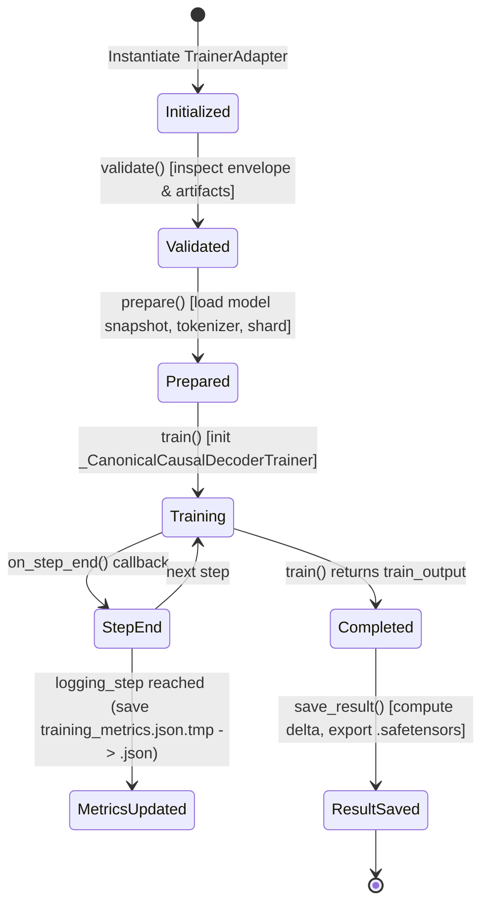
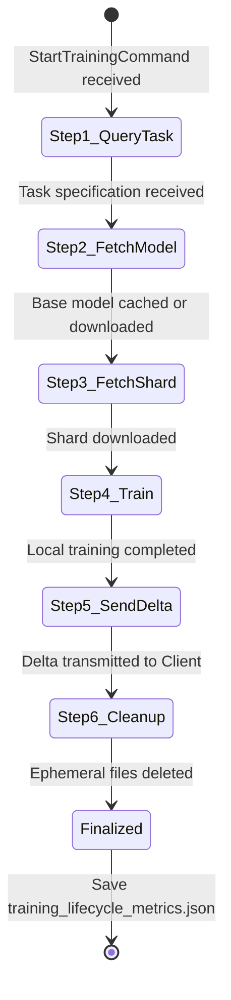

# Data Model Specification: Unified Training Metrics & Task Lifecycle Reporting

**Feature Branch**: `022-training-metrics-reporting`
**Spec Reference**: [spec.md](./spec.md)
**Status**: Completed

---

## 1. Domain Entities & Schemas

### Entity 1: `TrainingMetricsReport`

Represents the comprehensive fine-tuning progression and convergence record written by `CanonicalCausalDecoderTrainer` and `train_single_node.py` to `training_metrics.json`.

#### Schema & Fields

```typescript
interface TrainingMetricsReport {
  metadata: TrainingMetadata;
  steps: StepMetricRecord[];
  summary: TrainingSummary;
}

interface TrainingMetadata {
  model_name: string;             // e.g., "roneneldan/TinyStories-1M" or base model ID
  device: "cuda" | "cpu";         // Hardware device type
  device_name: string;            // GPU model name or "CPU"
  total_parameters: number;       // Total parameter count in model
  batch_size: number;             // Per-device batch size per step
  grad_accum_steps: number;       // Gradient accumulation steps
  effective_batch_size: number;   // batch_size * grad_accum_steps
  learning_rate: number;          // Base learning rate (e.g., 1e-4)
  max_seq_length: number;         // Maximum sequence length
  total_planned_steps: number;    // Planned total training steps
  num_epochs: number;             // Planned number of epochs
  steps_per_epoch: number;        // Calculated steps per epoch
  start_time: string;             // ISO-8601 UTC timestamp (e.g. "2026-10-27T15:00:00Z")
}

interface StepMetricRecord {
  step: number;                   // Global training step number (1-based)
  epoch: number;                  // Fractional epoch completed (e.g., 0.125)
  loss: number;                   // Moving average cross-entropy loss
  perplexity: number;             // Perplexity: exp(min(loss, 20.0))
  accuracy: number;               // Token prediction accuracy percentage (0.0 to 100.0)
  learning_rate: number;          // Current optimizer learning rate
  tokens_per_sec: number;         // Token throughput (processed tokens / elapsed time)
  total_tokens: number;           // Cumulative tokens processed up to this step
  elapsed_sec: number;            // Total elapsed training time in seconds
  vram_allocated_mb: number;      // VRAM allocated in MB (0.0 if CPU)
}

interface TrainingSummary {
  status: "completed" | "finished" | "failed"; // Completion status
  total_steps: number;            // Actual steps completed
  total_epochs_trained: number;   // Final epoch reached
  total_elapsed_sec: number;      // Total wall-clock duration of training
  total_tokens_processed: number; // Final token count processed
  average_tokens_per_sec: number; // Overall token processing throughput
  initial_loss: number | null;    // Loss at first logged step
  final_loss: number | null;      // Loss at final logged step
  initial_perplexity: number | null; // PPL at first logged step
  final_perplexity: number | null;   // PPL at final logged step
  initial_accuracy: number | null;   // Accuracy at first logged step
  final_accuracy: number | null;     // Accuracy at final logged step
  best_loss: number | null;       // Lowest loss recorded across training
  best_accuracy: number | null;   // Highest accuracy recorded across training
  best_step: number | null;       // Global step where best loss was achieved
  best_epoch: number | null;      // Epoch where best loss was achieved
}
```

#### Validation Rules
- `metadata.batch_size` >= 1, `grad_accum_steps` >= 1.
- `steps[*].perplexity` = $\exp(\min(\text{loss}, 20.0))$.
- `steps[*].accuracy` must be between 0.0 and 100.0.
- `summary.best_loss` must equal $\min(\text{steps}[*].\text{loss})$ if steps is non-empty.

---

### Entity 2: `TaskLifecycleReport`

Represents the execution timeline and stage duration measurements captured by `StartTrainingHandler` across its 6-step lifecycle and written to `training_lifecycle_metrics.json`.

#### Schema & Fields

```typescript
interface TaskLifecycleReport {
  task_metadata: TaskLifecycleMetadata;
  steps: LifecycleStageRecord[];
}

interface TaskLifecycleMetadata {
  client_node_id: string;         // Peer ID of dispatching client
  model_id: string;               // Target model identifier
  model_version: string;          // Target model baseline version
  data_set_id: string;            // Dataset identifier
  shard_id: string;               // Shard identifier assigned to worker
  status: "COMPLETED" | "FAILED"; // Overall execution outcome
  total_elapsed_sec: number;      // Sum of all stage durations
  start_time: string;             // ISO-8601 start timestamp
  end_time: string;               // ISO-8601 completion/failure timestamp
  error: string | null;           // Error message if overall status is FAILED
}

interface LifecycleStageRecord {
  step_number: number;            // 1 through 6
  name: string;                   // Canonical stage name
  status: "COMPLETED" | "FAILED" | "SKIPPED";
  start_time: string;             // ISO-8601 stage start timestamp
  end_time: string;               // ISO-8601 stage end timestamp
  duration_sec: number;           // Execution duration in seconds
  details?: Record<string, any>;  // Stage-specific attributes (e.g., file sizes, cache hits)
  error?: string | null;          // Error details if stage failed
}
```

#### Canonical Lifecycle Stages
1. `Step 1/6: Request training task specification over P2P`
2. `Step 2/6: Check local cache / stream base model over P2P`
3. `Step 3/6: Stream dataset shard over P2P`
4. `Step 4/6: Execute local training via PyTorch engine`
5. `Step 5/6: Transmit weight delta to Client over P2P`
6. `Step 6/6: Clean up ephemeral artifacts`

#### Validation Rules
- `steps` must contain entries in ascending order of `step_number` (1 to 6).
- If any stage has `status: "FAILED"`, subsequent stages are marked `"SKIPPED"` or omitted, and `task_metadata.status` must be `"FAILED"`.
- `total_elapsed_sec` must be within 5% of $\sum \text{duration\_sec}$.

---

### Entity 3: `CausalDecoderDatasetShard`

Represents the in-memory or persisted (`.pt`) dataset contract consumed by `CanonicalCausalDecoderTrainer`.

#### Structure
```python
{
    "input_ids": torch.Tensor,       # Shape: [N, seq_len], dtype: torch.long
    "attention_mask": torch.Tensor,  # Shape: [N, seq_len], dtype: torch.long (1 for content, 0 for pad)
    "labels": torch.Tensor,          # Shape: [N, seq_len], dtype: torch.long (-100 for masked prompt tokens)
}
```

#### Validation Rules
- All three tensors must be 2D (`ndim == 2`).
- Sample count `N` (`tensor.shape[0]`) must match across all three tensors.
- Sequence length `seq_len` (`tensor.shape[1]`) must match across all three tensors.
- Values in `labels` must match `input_ids` on target story tokens and `-100` on instruction/prompt tokens.

---

## 2. State Transitions & Lifecycle

### `CanonicalCausalDecoderTrainer` Training Lifecycle


### `StartTrainingHandler` Lifecycle

