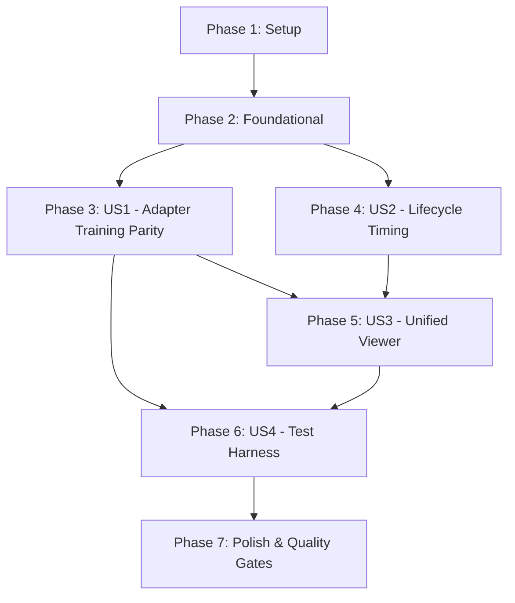

# Tasks: Unified Training Metrics & Task Lifecycle Reporting

**Input**: Design documents from `/specs/022-training-metrics-reporting/`
**Prerequisites**: [plan.md](./plan.md) (required), [spec.md](./spec.md) (required), [research.md](./research.md), [data-model.md](./data-model.md), [contracts/](./contracts/), [quickstart.md](./quickstart.md)
**Organization**: Tasks are grouped by user story to enable independent implementation and testing of each story.

## Format: `[ID] [P?] [Story] Description`

- **[P]**: Can run in parallel (different files, no dependencies)
- **[Story]**: Which user story this task belongs to (`[US1]`, `[US2]`, `[US3]`, `[US4]`)
- Every task includes an exact file path

---

## Phase 1: Setup (Shared Infrastructure)

**Purpose**: Verify repository structure and prepare target directories

- [X] T001 Verify directory structure and baseline dependencies in `src/distributed_training_engine/` and `samples/`

---

## Phase 2: Foundational (Blocking Prerequisites)

**Purpose**: Core utilities and schema contracts required before user story tasks

- [X] T002 [P] Implement atomic JSON file save utility function (`.tmp` write and `os.replace`) in `src/distributed_training_engine/adapters/canonical_causal_decoder/training/canonical_causal_decoder_trainer.py`
- [X] T003 [P] Validate schema definitions against target entities in `specs/022-training-metrics-reporting/contracts/training-metrics.schema.json` and `specs/022-training-metrics-reporting/contracts/lifecycle-metrics.schema.json`

**Checkpoint**: Core foundation validated - user story implementation can begin

---

## Phase 3: User Story 1 - Training Progress & Metric Parity in Canonical Causal Decoder Adapter (Priority: P1) 🎯 MVP

**Goal**: Establish parity between `CanonicalCausalDecoderTrainer` and `samples/comaparision_test/train_single_node.py` for token accuracy computation, stdout step logging, and continuous `training_metrics.json` export.

**Independent Test**: Execute adapter training on a small dataset shard; verify stdout displays step logs matching `Step X/Y (Ep E/N) | Loss: L | PPL: P | Acc: A% | Speed: S tok/s | Time: Ts` and produces a valid `training_metrics.json` file conforming to `training-metrics.schema.json`.

### Implementation for User Story 1

- [X] T004 [US1] Implement `_CanonicalCausalDecoderTrainer(Trainer)` subclass in `src/distributed_training_engine/adapters/canonical_causal_decoder/training/canonical_causal_decoder_trainer.py` to compute token accuracy on shifted logits and track token counts during forward passes
- [X] T005 [US1] Implement `_MetricsTrackingCallback(TrainerCallback)` in `src/distributed_training_engine/adapters/canonical_causal_decoder/training/canonical_causal_decoder_trainer.py` to compute windowed average loss, accuracy, and perplexity, format stdout progress, and track best metrics
- [X] T006 [US1] Integrate `_CanonicalCausalDecoderTrainer` and `_MetricsTrackingCallback` into `CanonicalCausalDecoderTrainer.prepare()` in `src/distributed_training_engine/adapters/canonical_causal_decoder/training/canonical_causal_decoder_trainer.py`, preserving existing `TrainingArguments` mapping
- [X] T007 [US1] Implement final summary metrics computation and continuous atomic export of `training_metrics.json` in `CanonicalCausalDecoderTrainer.train()` in `src/distributed_training_engine/adapters/canonical_causal_decoder/training/canonical_causal_decoder_trainer.py`

**Checkpoint**: User Story 1 complete - `CanonicalCausalDecoderTrainer` produces `training_metrics.json` and stdout logs with full parity to `train_single_node.py`.

---

## Phase 4: User Story 2 - Coordinator Start-Training Task Lifecycle Duration Reporting (Priority: P2)

**Goal**: Record millisecond-precision stage duration timings for all 6 execution stages in `StartTrainingHandler`, exporting `training_lifecycle_metrics.json`.

**Independent Test**: Invoke `StartTrainingHandler.handle()`; verify `training_lifecycle_metrics.json` is generated containing start/end timestamps, elapsed durations in seconds, and status for all 6 stages.

### Implementation for User Story 2

- [X] T008 [US2] Implement `TaskLifecycleRecorder` class in `src/Trainer/application/coordinator_commands/start_training/handler.py` to manage stage transitions, timestamps, and duration calculation
- [X] T009 [US2] Instrument all 6 lifecycle stages in `StartTrainingHandler.handle()` in `src/Trainer/application/coordinator_commands/start_training/handler.py` with `TaskLifecycleRecorder`
- [X] T010 [US2] Implement atomic export of `training_lifecycle_metrics.json` upon completion and inside exception handling in `src/Trainer/application/coordinator_commands/start_training/handler.py`

**Checkpoint**: User Story 2 complete - all 6 handler stages are timed and recorded to `training_lifecycle_metrics.json`.

---

## Phase 5: User Story 3 - Unified Training Task Inspection Tool in Comparison Suite (Priority: P3)

**Goal**: Enhance `show_single_node_train_result.py` with adaptive path discovery and implement `show_training_task_result.py` in `samples/comaparision_test` with resilient fallbacks.

**Independent Test**: Execute `python show_training_task_result.py` under all 4 availability permutations (both files present, training metrics only, lifecycle metrics only, neither file); verify clean Rich terminal rendering and zero crashes.

### Implementation for User Story 3

- [X] T011 [P] [US3] Enhance path discovery and optional CLI argument (`sys.argv[1]`) with fallback search in `samples/comaparision_test/show_single_node_train_result.py`
- [X] T012 [P] [US3] Implement report discovery hierarchy (`./`, `./work/`, `./single_node_finetuning/`) and fallback file loader in `samples/comaparision_test/show_training_task_result.py`
- [X] T013 [US3] Implement Rich-based terminal UI rendering lifecycle stage duration tables and model convergence charts in `samples/comaparision_test/show_training_task_result.py`
- [X] T014 [US3] Implement resilient fallback panels for missing reports and graceful exit in `samples/comaparision_test/show_training_task_result.py`

**Checkpoint**: User Story 3 complete - unified terminal inspection displays lifecycle and training metrics with crash-resilient fallbacks.

---

## Phase 6: User Story 4 - Standalone Training Report Test Harness (Priority: P4)

**Goal**: Provide a self-contained sample suite in `samples/training_report_test` that exercises download, data preparation, fast adapter training, report display, and resets with zero arguments.

**Independent Test**: Run sequentially with zero arguments: `download_artifacts.py` -> `prepare_data.py` -> `train.py` -> `show_report.py` -> `clean.py` -> `clean_artifacts.py`; verify 100% success without errors.

### Implementation for User Story 4

- [X] T015 [P] [US4] Create directory `samples/training_report_test` and replicate `download_artifacts.py` from `samples/comaparision_test/download_artifacts.py`
- [X] T016 [P] [US4] Implement `samples/training_report_test/prepare_data.py` to tokenize dataset into PyTorch `.pt` shard with label prompt masking, package `tinystories_base.tar.gz`, and write `causal_decoder_config.json`
- [X] T017 [US4] Implement zero-argument fast local training session via `distributed_training_engine` in `samples/training_report_test/train.py`
- [X] T018 [US4] Implement zero-argument report visualizer in `samples/training_report_test/show_report.py` calling `show_single_node_train_result.py`
- [X] T019 [P] [US4] Implement `samples/training_report_test/clean.py` to delete training and viewer outputs
- [X] T020 [P] [US4] Implement `samples/training_report_test/clean_artifacts.py` to delete downloaded artifacts and prepared data

**Checkpoint**: User Story 4 complete - self-contained zero-argument test suite fully operational.

---

## Phase 7: Polish & Cross-Cutting Quality Gates

**Purpose**: Verification, compilability check, and end-to-end execution validation

- [X] T021 [P] Run syntax and compilation validation (`python -m py_compile`) across all modified and newly created files per Constitution Principle VII
- [X] T022 Run end-to-end execution of `samples/training_report_test` zero-argument workflow per `quickstart.md`
- [X] T023 Verify `show_training_task_result.py` under all 4 report availability permutations per `quickstart.md`

---

## Dependencies & Execution Order

### Phase Dependencies

- **Setup (Phase 1)**: No dependencies - can start immediately.
- **Foundational (Phase 2)**: Depends on Setup (Phase 1) - blocks User Story 1.
- **User Story 1 (Phase 3)**: Depends on Foundational (Phase 2).
- **User Story 2 (Phase 4)**: Independent of US1; can proceed in parallel or immediately after Foundational.
- **User Story 3 (Phase 5)**: Depends on report schemas established in US1 and US2.
- **User Story 4 (Phase 6)**: Depends on US1 (adapter training parity) and US3 (viewer path resolution).
- **Polish (Phase 7)**: Depends on completion of all user story tasks.

### User Story Completion Graph

### Parallel Opportunities

- **Foundational**: T002 and T003 can run in parallel.
- **User Story 1 vs User Story 2**: US1 (adapter) and US2 (handler) touch completely different files and can run in parallel.
- **User Story 3**: T011 (`show_single_node_train_result.py`) and T012 (`show_training_task_result.py`) can run in parallel.
- **User Story 4**: T015 (`download_artifacts.py`), T016 (`prepare_data.py`), T019 (`clean.py`), and T020 (`clean_artifacts.py`) can run in parallel.

---

## Implementation Strategy

### MVP First (User Story 1 Only)
1. Complete Phase 1: Setup
2. Complete Phase 2: Foundational
3. Complete Phase 3: User Story 1 (`CanonicalCausalDecoderTrainer` training parity and `training_metrics.json`)
4. **Validate MVP**: Run adapter locally on a shard, confirm matching step progress and valid `training_metrics.json`.

### Incremental Delivery
1. Add User Story 2: Coordinator lifecycle timing in `StartTrainingHandler`.
2. Add User Story 3: `show_training_task_result.py` and adaptive path resolution in `show_single_node_train_result.py`.
3. Add User Story 4: Standalone test harness `samples/training_report_test/`.
4. Run Phase 7 quality gate: `py_compile` and end-to-end test execution.
