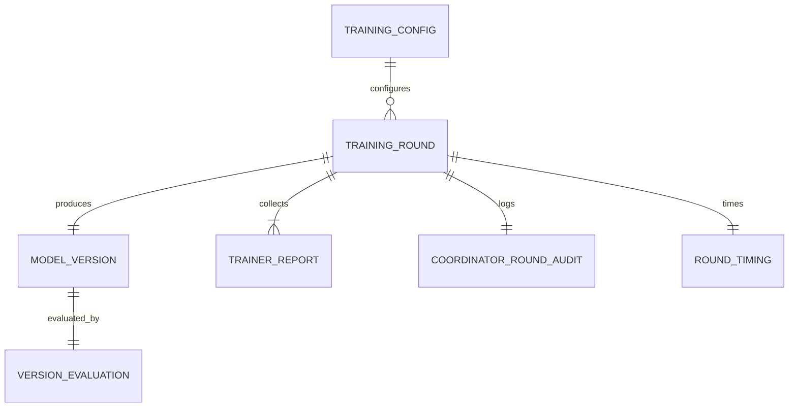
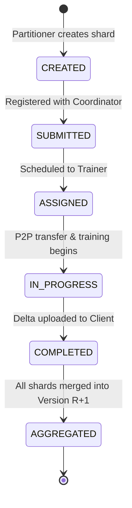

# Data Model: TinyStories Multi-Round Distributed Training Test & Visual Reporting

**Feature**: `023-tiny-stories-training-test`
**Date**: 2026-10-31

This document defines the key entities, lifecycle states, and structured JSON schemas utilized by the TinyStories distributed training test harness and reporting pipeline.

---

## 1. Key Entities & Domain Schemas



### 1.1 Training Configuration (`config.py`)
Central configuration module defining the hyperparameter constants and dataset limits:

| Parameter | Type | Default | Description |
|:---|:---|:---|:---|
| `BATCH_SIZE` | `int` | `16` | Micro-batch size per step (calibrated for GTX 1650 Ti ~200MB VRAM) |
| `GRAD_ACCUM_STEPS` | `int` | `2` | Gradient accumulation steps (effective batch size = 32) |
| `LEARNING_RATE` | `float` | `1e-4` | Fine-tuning learning rate (prevents weight thrashing) |
| `WEIGHT_DECAY` | `float` | `0.01` | AdamW weight decay regularization |
| `MAX_SEQ_LENGTH` | `int` | `288` | Sequence length (captures >95% of full stories) |
| `MAX_STEPS` | `Optional[int]` | `None` | Max steps per epoch (or integer override for fast testing) |
| `WARMUP_STEPS` | `int` | `20` | Linear learning rate warmup steps |
| `LOG_EVERY_STEPS` | `int` | `5` | Metric logging frequency |
| `MAX_TRAIN_SAMPLES` | `int` | `5000` | Subset size sampled from TinyStories dataset |
| `SEED` | `int` | `42` | Random seed for data shuffling and initialization |
| `ROUNDS` | `int` | `5` | Default number of sequential federated training rounds |

---

### 1.2 Round Timing Metric (`reports/round_timings.json`)
Tracks the wall-clock execution spans for each round from submission to aggregation:

```json
{
  "total_rounds": 5,
  "total_elapsed_seconds": 384.52,
  "rounds": [
    {
      "round": 1,
      "base_model_version": 0,
      "produced_model_version": 1,
      "submitted_at": "2026-10-31T14:00:00.123456Z",
      "completed_at": "2026-10-31T14:01:15.654321Z",
      "elapsed_seconds": 75.53,
      "phases": {
        "sharding_duration_seconds": 2.1,
        "training_duration_seconds": 68.3,
        "aggregation_duration_seconds": 5.13
      },
      "shards_completed": 2
    }
  ]
}
```

---

### 1.3 Coordinator Execution Audit (`reports/coordinator_summary.json`)
Telemetry extracted from ASP.NET Core coordinator logs capturing task scheduling events:

```json
{
  "total_tasks_scheduled": 5,
  "rounds": [
    {
      "round": 1,
      "model_version": 0,
      "task_id": "tinystories_0_tinystories",
      "registered_at": "2026-10-31T14:00:02.100Z",
      "assignments": [
        {
          "shard_id": 0,
          "trainer_node_id": "trainer-node-01",
          "assigned_at": "2026-10-31T14:00:03.250Z",
          "completed_at": "2026-10-31T14:01:10.500Z"
        },
        {
          "shard_id": 1,
          "trainer_node_id": "trainer-node-02",
          "assigned_at": "2026-10-31T14:00:03.260Z",
          "completed_at": "2026-10-31T14:01:12.800Z"
        }
      ],
      "scheduling_latency_seconds": 1.16,
      "status": "COMPLETED"
    }
  ]
}
```

---

### 1.4 Model Version Evaluation (`reports/version_evaluations.json`)
Quantitative quality metrics evaluated on the prepared training dataset:

```json
{
  "model_id": "tinystories",
  "evaluated_at": "2026-10-31T14:10:00Z",
  "eval_dataset_samples": 5000,
  "versions": [
    {
      "version": 0,
      "is_baseline": true,
      "loss": 3.8421,
      "perplexity": 46.623,
      "top1_accuracy": 0.4215,
      "archive_path": "artifacts/tinystories_base.tar.gz"
    },
    {
      "version": 1,
      "is_baseline": false,
      "loss": 3.2150,
      "perplexity": 24.891,
      "top1_accuracy": 0.5082,
      "loss_delta_percent": -16.32,
      "perplexity_delta_percent": -46.61,
      "accuracy_delta_percent": 20.57,
      "archive_path": "work/client_artifacts/models/tinystories/v1/tinystories_v1.gz"
    }
  ]
}
```

---

### 1.5 Trainer Metric Report Structure (`reports/trainers/`)
Directory tree archiving trainer-side execution artifacts per round:

```text
reports/
├── round_timings.json
├── coordinator_summary.json
├── version_evaluations.json
├── training_progression_plot.png
└── trainers/
    ├── round_1/
    │   ├── trainer1/
    │   │   ├── training_metrics.json
    │   │   └── training_lifecycle_metrics.json
    │   └── trainer2/
    │       ├── training_metrics.json
    │       └── training_lifecycle_metrics.json
    ├── round_2/
    │   └── ...
    └── round_5/
        └── ...
```

---

## 2. Shard & Model Lifecycle States


