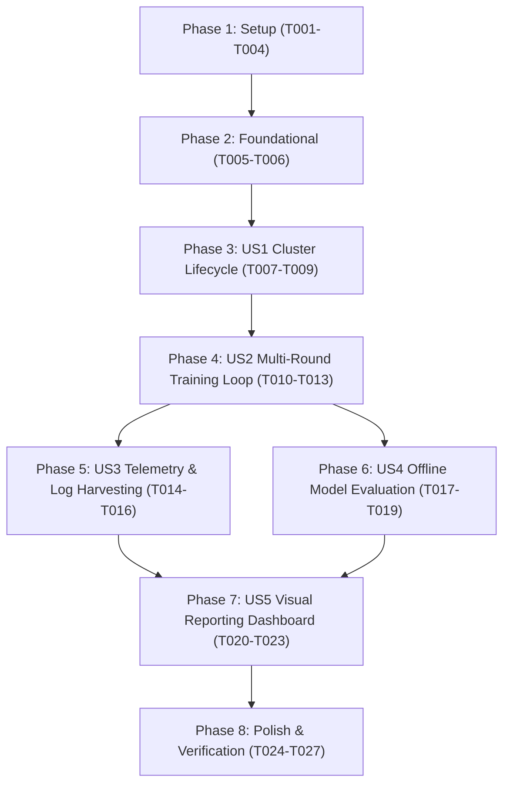

# Tasks: TinyStories Multi-Round Distributed Training Test & Visual Reporting

**Input**: Design documents from `specs/023-tiny-stories-training-test/`
**Prerequisites**: [plan.md](file:///C:/Users/azure-dev/dev/TrainSwarm/specs/023-tiny-stories-training-test/plan.md), [spec.md](file:///C:/Users/azure-dev/dev/TrainSwarm/specs/023-tiny-stories-training-test/spec.md), [research.md](file:///C:/Users/azure-dev/dev/TrainSwarm/specs/023-tiny-stories-training-test/research.md), [data-model.md](file:///C:/Users/azure-dev/dev/TrainSwarm/specs/023-tiny-stories-training-test/data-model.md), [contracts/](file:///C:/Users/azure-dev/dev/TrainSwarm/specs/023-tiny-stories-training-test/contracts)

---

## Phase 1: Setup (Shared Infrastructure)

**Purpose**: Initialize directory structure, configuration module, and asset preparation scripts.

- [x] T001 Initialize test suite directory at samples/tiny_stories_training_test/
- [x] T002 [P] Create configuration module with hyperparameter constants in samples/tiny_stories_training_test/config.py
- [x] T003 [P] Copy and adapt Hugging Face asset downloader in samples/tiny_stories_training_test/download_artifacts.py
- [x] T004 Adapt dataset tokenizer and base model archiver in samples/tiny_stories_training_test/prepare_data.py to import from config.py

---

## Phase 2: Foundational (Blocking Prerequisites)

**Purpose**: Core cleanup, process tracking, and filesystem isolation required before executing any cluster or training operations.

- [x] T005 Implement process termination, port clearing, and container teardown in samples/tiny_stories_training_test/clean.py
- [x] T006 [P] Implement runtime directory initialization helper for work/ and reports/ in samples/tiny_stories_training_test/clean.py

---

## Phase 3: User Story 1 - Cluster Lifecycle & Environment Orchestration (Priority: P1)

**Goal**: Bootstrap and manage the complete 8-component TrainSwarm distributed cluster natively or via Docker control-plane containers.

**Independent Test**: Run `python setup.py` (or `python setup_docker.py`) and confirm health endpoints `http://127.0.0.1:8090/health` and `http://127.0.0.1:8080/health` respond with HTTP 200, all 8 processes/containers start, and `python clean.py` cleans up all ports and PIDs cleanly.

### Implementation for User Story 1

- [x] T007 [US1] Implement native 8-process cluster launcher with health polling and PID tracking in samples/tiny_stories_training_test/setup.py
- [x] T008 [US1] Implement Docker hybrid cluster launcher using direct docker run commands for Coordinator and Relay in samples/tiny_stories_training_test/setup_docker.py
- [x] T009 [US1] Implement health check and cluster connectivity validation routines in samples/tiny_stories_training_test/setup.py

---

## Phase 4: User Story 2 - Iterative Multi-Round Distributed Training Loop (Priority: P1)

**Goal**: Execute iterative, multi-round distributed training where the aggregated model output from round $R$ is chained as the baseline input for round $R+1$.

**Independent Test**: Run `python train.py --rounds 2` and confirm round 1 takes Version 0 to produce Version 1, and round 2 takes Version 1 to produce Version 2.

### Implementation for User Story 2

- [x] T010 [US2] Implement CLI argument parser with configurable rounds (--rounds, default from config.py) in samples/tiny_stories_training_test/train.py
- [x] T011 [US2] Implement training task submission logic via Client CLI in samples/tiny_stories_training_test/train.py
- [x] T012 [US2] Implement SQLite database polling for shard completion and model aggregation in samples/tiny_stories_training_test/train.py
- [x] T013 [US2] Implement sequential round chaining to pass aggregated model archives to subsequent rounds in samples/tiny_stories_training_test/train.py

---

## Phase 5: User Story 3 - Structured Metric Harvesting & Coordinator Audit Extraction (Priority: P2)

**Goal**: Harvest trainer-side metric logs per round into `reports/trainers/`, persist submission-to-aggregation elapsed spans in `reports/round_timings.json`, and extract Coordinator scheduling telemetry into `reports/coordinator_summary.json`.

**Independent Test**: After running `train.py`, verify `reports/trainers/round_1/trainer1/` contains metric files, `reports/round_timings.json` contains valid round duration records, and `reports/coordinator_summary.json` contains parsed task scheduling timestamps.

### Implementation for User Story 3

- [x] T014 [US3] Implement trainer artifact harvester archiving training_metrics.json per node and round in samples/tiny_stories_training_test/train.py
- [x] T015 [US3] Implement submit-to-aggregation elapsed duration tracker writing reports/round_timings.json in samples/tiny_stories_training_test/train.py
- [x] T016 [US3] Implement Coordinator log parser extracting task registration, scheduling latency, and assignments into reports/coordinator_summary.json in samples/tiny_stories_training_test/train.py

---

## Phase 6: User Story 4 - Cross-Version Validation & Model Quality Evaluation (Priority: P2)

**Goal**: Evaluate baseline model (v0) and all generated model versions (v1..vN) against the prepared training dataset to compute loss, top-1 accuracy, and perplexity.

**Independent Test**: Run `python verify.py` against generated model versions and verify `reports/version_evaluations.json` is populated with loss, perplexity, and token accuracy records across all versions.

### Implementation for User Story 4

- [x] T017 [US4] Implement model archive unpacker and PyTorch batch evaluator in samples/tiny_stories_training_test/verify.py
- [x] T018 [US4] Implement loss, perplexity, and masked top-1 token prediction accuracy calculation in samples/tiny_stories_training_test/verify.py
- [x] T019 [US4] Implement cross-version evaluation aggregator exporting reports/version_evaluations.json in samples/tiny_stories_training_test/verify.py

---

## Phase 7: User Story 5 - Rich Visual Reporting & Learning Progression Visualization (Priority: P3)

**Goal**: Ingest all report JSON files and display a Rich terminal dashboard with tables, terminal ASCII/Unicode charts, and generate high-resolution progression plots.

**Independent Test**: Run `python show_reports.py` and confirm terminal tables render without errors, an inline ASCII graph displays accuracy and perplexity progression, and `reports/training_progression_plot.png` is generated.

### Implementation for User Story 5

- [x] T020 [US5] Implement Rich terminal report dashboard rendering progression and timing tables in samples/tiny_stories_training_test/show_reports.py
- [x] T021 [US5] Implement inline ASCII/Unicode progression trend graph for terminal display in samples/tiny_stories_training_test/show_reports.py
- [x] T022 [US5] Implement dual-presentation Matplotlib plotter generating reports/training_progression_plot.png in samples/tiny_stories_training_test/show_reports.py
- [x] T023 [US5] Implement process duration and Coordinator audit summary tables in samples/tiny_stories_training_test/show_reports.py

---

## Phase 8: Polish & Cross-Cutting Concerns

**Purpose**: System verification, compilability gates, and clean execution checks.

- [x] T024 [P] Run syntax and compilability verification (python -m py_compile) across all test scripts per Constitution Principle VII
- [x] T025 Execute 2-round end-to-end verification run (python train.py --rounds 2) to validate distributed cluster execution
- [x] T026 Execute model verification (python verify.py) and visual report dashboard (python show_reports.py) on the 2-round test artifacts
- [x] T027 Execute clean teardown (python clean.py) and verify all ports and processes are released cleanly

---

## Dependencies & Execution Order

### User Story Dependencies

- **US1 (Cluster Lifecycle)**: Depends on Foundational phase. Can be verified independently by starting and stopping the cluster.
- **US2 (Training Loop)**: Depends on US1 (running cluster) and Setup (data prepared). Core engine for generating model versions.
- **US3 (Telemetry & Harvesting)**: Integrates into US2 training loop completion. Captures time spans and trainer metrics per round.
- **US4 (Model Evaluation)**: Operates on model archives produced by US2 and training dataset from Setup.
- **US5 (Visual Dashboard)**: Operates on JSON artifacts produced by US3 and US4.
- **Polish**: Final integration verification proving the entire distributed system works end-to-end.

---

## Implementation Strategy

### MVP Milestone (US1 + US2 + US3)
1. Complete Setup and Foundational phases.
2. Complete US1 to confirm reliable cluster boot and teardown.
3. Complete US2 and US3 to execute a 2-round training run, collecting telemetry and aggregating models.
4. Validate with `python train.py --rounds 2`.

### Full Analytics Milestone (US4 + US5 + Polish)
1. Complete US4 to evaluate model loss, accuracy, and perplexity across versions.
2. Complete US5 to render Rich terminal tables, inline charts, and generate `training_progression_plot.png`.
3. Complete Polish tasks (compilation checks and full lifecycle test).
